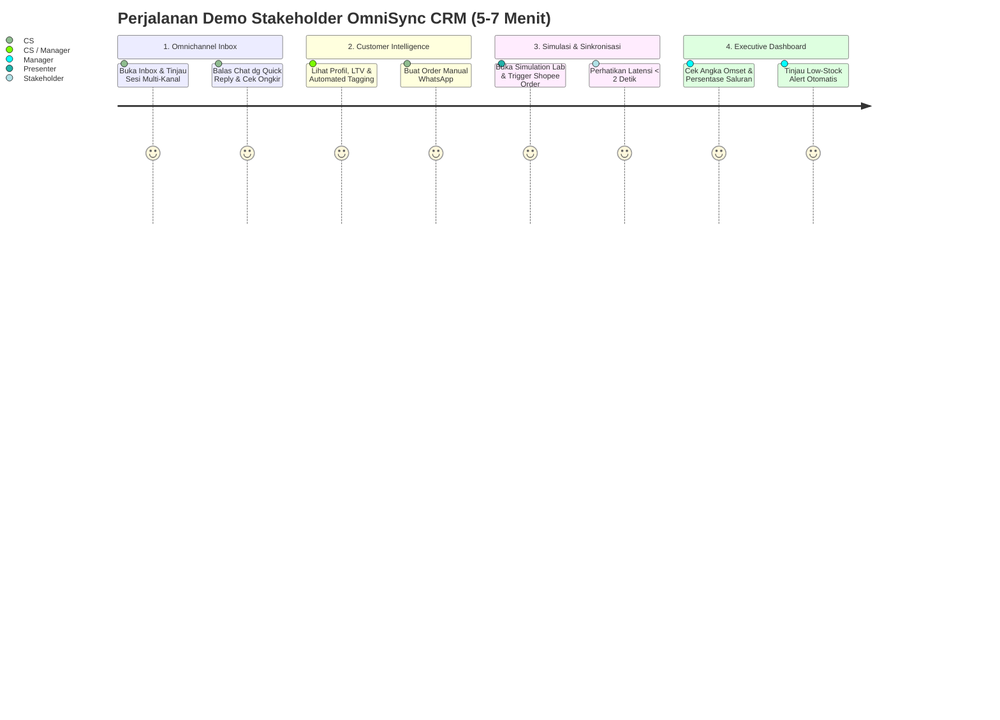

# OmniSync CRM — Omnichannel E-Commerce CRM & Real-Time Inventory Sync

[](https://www.typescriptlang.org/)
[](https://react.dev/)
[](https://expressjs.com/)
[](https://socket.io/)
[](https://tailwindcss.com/)
[](https://pglite.dev/)

**OmniSync CRM** adalah aplikasi MVP demonstrasi Customer Relationship Management (CRM) dan sinkronisasi inventori *omnichannel* untuk bisnis e-commerce multi-platform. 

Studi kasus implementasi: **"Rancaekek Supply Co."**, sebuah brand apparel dan perlengkapan hiking/outdoor lokal asal Jawa Barat. Proyek ini mensimulasikan integrasi marketplace (*Shopee, Tokopedia, Lazada, Blibli, dan WhatsApp*) tanpa ketergantungan pada API marketplace resmi yang berbayar atau rumit, dirancang khusus untuk presentasi dan demonstrasi kapabilitas kepada *stakeholder* bisnis dan calon investor.

---

## 🚀 Masalah Bisnis yang Diselesaikan

1. **CS Overhead**: Customer Service harus membuka banyak aplikasi marketplace secara terpisah untuk membalas pesan dan mengecek order.
2. **Overselling / Out-of-Stock Risk**: Sinkronisasi stok antar marketplace yang terlambat (seringkali delay 5–30 menit pada sistem tradisional) mengakibatkan pesanan ganda saat barang langka.
3. **Data Pelanggan Terfragmentasi**: Riwayat pembelian, preferensi kanal, dan Lifetime Value (LTV) tersebar di berbagai platform tanpa profil tunggal (*single customer view*).

---

## 🌟 Fitur Utama

- **Unified Omnichannel Inbox (3-Kolom Layout)**:
  - Menggabungkan chat dari Shopee, Tokopedia, Lazada, Blibli, dan WhatsApp dalam satu antrean terpadu.
  - Filter kanal, badge status urgensi, preview unread badge, auto-scroll chat workspace.
  - Template balasan cepat (*Quick Replies*), bagikan katalog produk langsung ke obrolan, dan kalkulator estimasi ongkos kirim (JNE, J&T, SiCepat).
- **Customer Intelligence & Profiling**:
  - Profil instan pelanggan: Lifetime Value (Rp), total pesanan, tier loyalitas, 5 riwayat transaksi terakhir.
  - *Automated Rule-Based Tagging*: Deteksi otomatis tag **VIP** (LTV $\ge$ Rp 3.000.000 atau $\ge$ 5 order), **Suka Retur** ($\ge$ 2 retur), **Pending Payment**, dan **New Customer**.
  - Modal **Create Order** langsung dari obrolan WhatsApp yang secara otomatis memotong stok global dan memperbarui LTV.
- **Sinkronisasi Stok Multi-Kanal Berlatensi Rendah (< 2 Detik)**:
  - Pemotongan stok multi-kanal serentak dalam **1 transaksi database ACID**.
  - Idempoten: pengiriman webhook berulang dengan `external_order_id` yang sama dijamin tidak memotong stok ganda.
  - Validasi stok non-negatif: penolakan otomatis HTTP 409 (*Conflict*) dengan pesan jelas jika stok tidak mencukupi.
- **Executive Analytics Dashboard**:
  - Metrik KPI bisnis: Total Omset, Pesanan Sukses, Open Chats, Rata-rata Waktu Respons CS (*First Response Time*).
  - Perbandingan omset per saluran penjualan dalam persentase (%) dan nominal Rp yang dihitung akurat dari tabel pesanan.
  - Grafik tren penjualan 30 hari terakhir.
  - Tabel matriks stok SKU lintas 4 marketplace dengan highlight status low-stock.
  - Panel **Low-Stock Alerts** interaktif yang otomatis muncul seketika saat stok SKU $\le$ ambang batas (*threshold*).
- **Simulation Lab & Live Webhook Tester**:
  - Drawer simulasi untuk memicu pesanan atau pesan webhook secara instan.
  - Mesin simulasi otomatis berulang dengan jeda waktu yang dapat dikonfigurasi.
  - Log audit real-time dengan rincian latensi sinkronisasi dalam milidetik (*ms*).
  - Fitur **Reset Demo Data** sekali klik untuk mengembalikan kondisi data awal kapan pun diperlukan.
- **Aesthetic UI & Dark Mode**:
  - Toggle Mode Gelap (*Dark Mode*) di header dengan persistensi `localStorage`.
  - Desain modern, transisi halus, loading skeleton, empty states, dan tata letak responsif (*Desktop, Tablet, Mobile*).

---

## 🛠️ Arsitektur & Teknologi

| Lapisan | Teknologi | Deskripsi |
| :--- | :--- | :--- |
| **Frontend** | React 19, TypeScript, Vite, TailwindCSS | Antarmuka pengguna responsif, single-page application |
| **Icons & UI** | Lucide React | Ikonografi modern dan konsisten |
| **Backend** | Node.js, Express 4.21, TypeScript, TSX | RESTful API & webhook ingestion engine |
| **Real-Time** | Socket.io 4.8 | Komunikasi dua arah untuk siaran stok, chat, dan pembaruan dashboard |
| **Database** | `@electric-sql/pglite` (Embedded PostgreSQL) | Database PostgreSQL embedded in-process, tanpa instalasi server DB eksternal |

---

## 📦 Panduan Instalasi & Menjalankan

### Prasyarat
- **Node.js**: Versi 18.0.0 atau lebih baru
- **npm**: Versi 9.0.0 atau lebih baru

### 1. Kloning dan Instal Dependensi
Buka terminal pada direktori proyek utama (`c:/laragon/www/Omnysync`):

```bash
# 1. Instal dependensi backend
cd backend
npm install

# 2. Instal dependensi frontend
cd ../frontend
npm install

# 3. Kembali ke root
cd ..
```

### 2. Menjalankan Server Development

Anda dapat menjalankan kedua server secara bersamaan dari dua jendela terminal:

**Terminal 1 (Backend API & Socket.io pada Port 5000):**
```bash
cd backend
npm run dev
```

**Terminal 2 (Frontend Client pada Port 5173):**
```bash
cd frontend
npm run dev
```

Buka peramban web dan akses: **`http://localhost:5173/`**

---

## 🔄 Perintah Seed & Reset Data

Basis data telah dilengkapi seeder bawaan dengan produk outdoor Rancaekek Supply Co., variasi SKU, stok multi-channel, 50 pelanggan Indonesia, riwayat 70+ pesanan 30 hari, dan riwayat obrolan omni-channel.

### Menjalankan Seeder via CLI:
```bash
# Dari folder backend
cd backend
npm run seed:reset
```

### Reset Data Langsung dari UI:
Klik menu **Simulation Lab** di navigasi atas, lalu klik tombol **"Reset Data Demo"** di pojok kanan atas. Basis data akan diisi ulang ke kondisi awal secara instan dan tampilan web akan otomatis tersinkronisasi tanpa refresh manual.

### Menjalankan Seluruh Pengecekan Acceptance Criteria:
```bash
cd backend
npm run test:acceptance
```

---

## 📡 Daftar Endpoint API

### 1. Webhook Simulasi Marketplace
| Method | Endpoint | Deskripsi |
| :--- | :--- | :--- |
| `POST` | `/api/webhooks/:platform/order` | Simulasi order masuk (:platform: `shopee`, `tokopedia`, `lazada`, `blibli`, `whatsapp`) |
| `POST` | `/api/webhooks/:platform/message` | Simulasi pesan obrolan masuk dari pelanggan |

### 2. Chat & Customer Service
| Method | Endpoint | Deskripsi |
| :--- | :--- | :--- |
| `GET` | `/api/chats` | Mendapatkan daftar seluruh sesi obrolan inbox |
| `GET` | `/api/chats/:id/messages` | Mendapatkan riwayat pesan dalam sesi tertentu |
| `POST` | `/api/chats/:id/messages` | Mengirimkan balasan pesan dari CS |
| `PATCH` | `/api/chats/:id/status` | Memperbarui status sesi (`open` / `resolved`) |

### 3. Customer & Orders
| Method | Endpoint | Deskripsi |
| :--- | :--- | :--- |
| `GET` | `/api/customers` | Mengambil daftar pelanggan |
| `GET` | `/api/customers/:id` | Mengambil detail profil pelanggan, LTV, loyalty, tag, dan 5 riwayat pesanan |
| `GET` | `/api/orders` | Mengambil daftar pesanan |
| `POST` | `/api/orders` | Membuat pesanan manual CS WhatsApp (memotong stok 4 channel sekaligus) |
| `PATCH` | `/api/orders/:id/status` | Memperbarui status pesanan (`paid`, `shipped`, `completed`, `returned`, `cancelled`) |

### 4. Inventori & Analitik
| Method | Endpoint | Deskripsi |
| :--- | :--- | :--- |
| `GET` | `/api/products` | Mengambil katalog produk dan matriks stok channel |
| `GET` | `/api/analytics/dashboard` | Mengambil statistik ringkasan, persentase kanal, grafik tren 30 hari, dan low-stock alerts |
| `POST` | `/api/demo/reset` | Mereset basis data ke kondisi awal seeder secara in-memory |

---

## 📝 Contoh Payload JSON Webhook

### 1. Webhook Order Masuk (`POST /api/webhooks/:platform/order`)
Ganti `:platform` dengan salah satu dari: `shopee`, `tokopedia`, `lazada`, `blibli`, atau `whatsapp`.

```json
{
  "external_order_id": "SHP-20261001-9012",
  "customer": {
    "name": "Budi Santoso",
    "phone": "0812-1111-2222"
  },
  "items": [
    {
      "sku": "RS-FLC-RNJ-GRY-M",
      "qty": 1
    }
  ],
  "status": "paid"
}
```

**Contoh Response Sukses (201 Created):**
```json
{
  "status": "success",
  "message": "Pesanan Shopee berhasil diproses dan disinkronkan ke seluruh kanal",
  "sync_latency_ms": 284,
  "order_id": 172,
  "external_order_id": "SHP-20261001-9012",
  "affected_variants": [
    {
      "sku": "RS-FLC-RNJ-GRY-M",
      "channels": [
        { "platform": "shopee", "stock": 31, "low_stock_threshold": 5 },
        { "platform": "tokopedia", "stock": 15, "low_stock_threshold": 5 },
        { "platform": "lazada", "stock": 10, "low_stock_threshold": 5 },
        { "platform": "blibli", "stock": 16, "low_stock_threshold": 5 }
      ],
      "total_stock": 72
    }
  ]
}
```

### 2. Webhook Pesan Masuk (`POST /api/webhooks/:platform/message`)
```json
{
  "customer": {
    "name": "Dewi Lestari",
    "phone": "0813-8888-9999"
  },
  "message": "Kak, untuk tenda dan tas carrier 40L Papandayan warna biru apakah ready siap kirim hari ini?",
  "urgency": "high"
}
```

**Contoh Response Sukses (201 Created):**
```json
{
  "status": "success",
  "data": {
    "session": {
      "id": 85,
      "customer_id": 3,
      "platform": "tokopedia",
      "last_message": "Kak, untuk tenda dan tas carrier 40L Papandayan warna biru apakah ready siap kirim hari ini?",
      "unread_count": 1,
      "urgency": "high"
    },
    "message": {
      "id": 1420,
      "session_id": 85,
      "sender": "customer",
      "body": "Kak, untuk tenda dan tas carrier 40L Papandayan warna biru apakah ready siap kirim hari ini?"
    }
  }
}
```

---

## 🎭 Skenario Demo 5–7 Menit untuk Stakeholder

Ikuti panduan berikut saat mendemonstrasikan sistem kepada stakeholder atau audiens manajemen:



### **Menit 0:00 – 1:30 | Bagian 1: Unified Omnichannel Inbox**
1. **Buka Aplikasi**: Pada header, pastikan role berada pada posisi **CS Rep**.
2. **Jelaskan Antarmuka**: Tunjukkan layout 3 kolom (Inbox List di kiri, Chat Workspace di tengah, Customer Profile di kanan).
3. **Soroti Badge Kanal**: Tunjukkan obrolan yang masuk dari WhatsApp (hijau), Shopee (oranye), Tokopedia (hijau tua), Lazada (biru), dan Blibli (biru tua) dalam satu antrean seragam.
4. **Pilih Obrolan**: Klik salah satu chat pelanggan, misalnya *Dewi Lestari*.
5. **Gunakan Quick Actions**:
   - Klik **Template Balasan** dan pilih salah satu template (misal: *"Stok Tersedia"*).
   - Klik **Bagi Katalog**, pilih *Jaket Gunung Stormbreaker*, dan amati kartu produk langsung tersemat di gelembung obrolan.
   - Klik **Cek Ongkir**, ubah kota tujuan menjadi *Surabaya*, klik *Kirim Ringkasan ke Chat*.

### **Menit 1:30 – 3:00 | Bagian 2: Customer Intelligence & Create Order Manual**
1. **Analisis Profil Pelanggan**:
   - Di panel kanan, tunjukkan Lifetime Value (LTV), jumlah total pesanan, dan tag otomatis seperti **VIP** atau **Pending Payment**.
   - Tunjukkan 5 riwayat pesanan sebelumnya yang transparan lintas kanal.
2. **Buat Pesanan Manual WhatsApp**:
   - Klik tombol hijau **Create Order** di kanan atas panel profil.
   - Pilih produk *Sarung Tangan Windstopper Grip Gede (Hitam - L)*, tentukan Qty = 1.
   - Klik **Konfirmasi Buat Pesanan**.
3. **Amati Hasil Otomatis**:
   - Gelembung konfirmasi pesanan resmi beserta nomor resi fiktif otomatis terkirim ke obrolan pelanggan.
   - LTV pelanggan langsung bertambah secara instan.
   - Tag pelanggan dievaluasi ulang secara real-time.

### **Menit 3:00 – 4:30 | Bagian 3: Simulasi Webhook & Sinkronisasi Real-Time**
1. **Buka Simulation Lab**: Klik menu **Simulation Lab** di navigasi atas.
2. **Uji Simulasi Order Shopee**:
   - Pada kartu kiri, pilih kanal: **Shopee**.
   - Pilih SKU: `RS-FLC-RNJ-GRY-M` (*Jaket Polar Fleece Thermal Rinjani - Abu - M*).
   - Masukkan Qty: `1`.
   - Klik **Kirim Order Simulasi**.
3. **Tunjukkan Hasil di Log Audit**:
   - Sorot response JSON: status `201 Created`.
   - Tunjukkan **Latensi Pemrosesan (< 500 ms)** yang tercatat pada log.
   - Perhatikan bahwa stok SKU tersebut terpotong **1 unit di Tokopedia, Lazada, dan Blibli secara serentak**.

### **Menit 4:30 – 6:00 | Bagian 4: Dashboard Executive & Low-Stock Alert**
1. **Buka Dashboard**: Klik tab **Dashboard** di navigasi atas (atau gunakan tombol *Switch Role* ke **Manager**).
2. **Verifikasi Angka Real-Time Tanpa Refresh**:
   - Tunjukkan total penjualan dan total order yang langsung mencerminkan pesanan yang baru saja dibuat.
   - Sorot grafik persentase penjualan per saluran: jelaskan bahwa persentase dihitung secara akurat langsung dari tabel transaksi pesanan riil.
3. **Tunjukkan Low-Stock Alert**:
   - Arahkan perhatian ke banner kuning/merah **"Low-Stock Alerts"**.
   - Tunjukkan bahwa SKU yang stoknya jatuh di bawah ambang batas ($\le 5$) langsung muncul sebagai peringatan prioritas agar tim gudang segera melakukan *restock*.
4. **Tunjukkan Toggle Dark Mode**:
   - Klik ikon **Bulan / Matahari** di header untuk mendemonstrasikan pengalaman visual premium dalam mode gelap.

### **Menit 6:00 – 7:00 | Bagian 5: Tanya Jawab & Reset Data**
1. Tunjukkan fitur **Reset Data Demo** untuk mengembalikan seluruh sistem ke kondisi semula dalam hitungan detik.
2. Buka sesi tanya jawab dengan para stakeholder.

---

## 📮 Postman Collection

File koleksi Postman yang siap diimpor tersedia di root direktori proyek:
📁 **[`omnisync_postman_collection.json`](file:///c:/laragon/www/Omnysync/omnisync_postman_collection.json)**

Cara mengimpor:
1. Buka aplikasi **Postman**.
2. Klik tombol **Import** di kiri atas.
3. Seret atau pilih file `omnisync_postman_collection.json`.
4. Seluruh endpoint webhook dan operasional akan siap digunakan dengan variabel `{{base_url}}` default ke `http://localhost:5000`.

---

## 📄 Lisensi
Hak Cipta © 2026 Rancaekek Supply Co. / OmniSync CRM. Dibuat untuk tujuan demonstrasi dan evaluasi produk.
